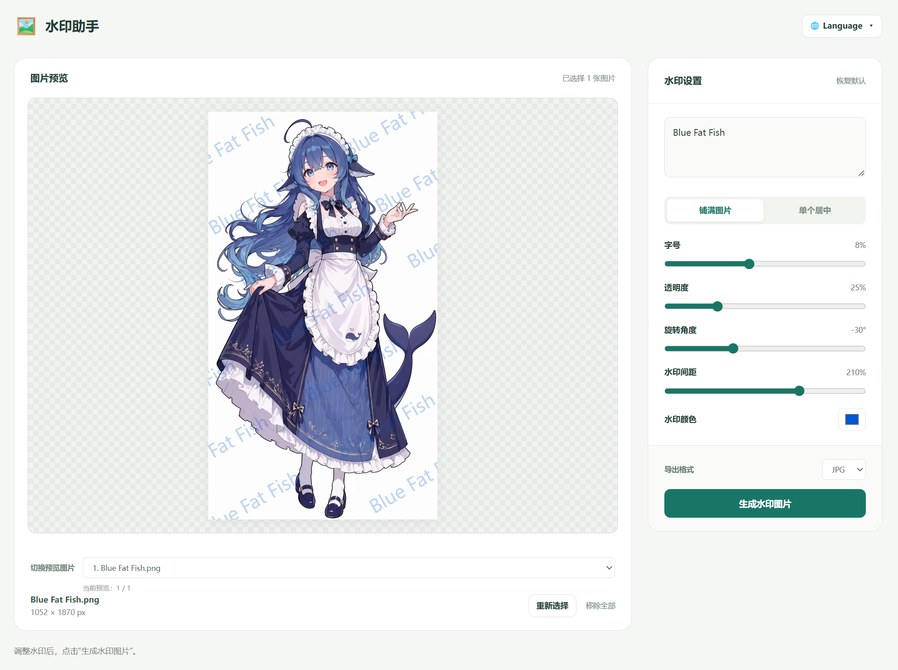

# 🖼️ 水印助手 · Watermark Assistant

## 🇨🇳 中文

- **项目做什么：** 为 JPG、PNG、WebP 图片添加文字水印，支持批量处理，导出 JPG 或 PNG。
- **为什么有用：** 图片仅在浏览器本地处理，不上传服务器。单个 HTML 文件，无需安装，可离线使用。
- **如何使用：** 下载 index.html 文件，用支持 JavaScript 的浏览器打开，选择图片、输入水印并调整参数，点击“生成水印图片”后保存。暂不支持 HEIC/HEIF。

## 🇺🇸 English

- **What it does:** Add text watermarks to JPG, PNG, and WebP images. Supports batch processing and JPG/PNG export.
- **Why it’s useful:** Images stay in your browser and are never uploaded. A single HTML file works offline with no installation.
- **How to use:** Download the index.html file and open it in a browser with JavaScript enabled. Select images, enter your watermark, adjust the settings, then generate and save the results. HEIC/HEIF is not supported.

## 🇯🇵 日本語

- **できること：** JPG・PNG・WebP画像に文字の透かしを追加できます。一括処理とJPG・PNG形式での書き出しに対応しています。
- **便利な理由：** 画像はブラウザ内で処理され、サーバーに送信されません。HTMLファイル1つで、インストール不要・オフラインでも使えます。
- **使い方：** index.htmlファイルをダウンロードし、JavaScriptが有効なブラウザで開きます。画像を選び、透かしの文字と設定を調整して、生成した画像を保存します。HEIC・HEIFには対応していません。

## 🇰🇷 한국어

- **주요 기능:** JPG, PNG, WebP 이미지에 텍스트 워터마크를 추가합니다. 여러 이미지를 한 번에 처리하고 JPG 또는 PNG로 저장할 수 있습니다.
- **유용한 이유:** 이미지는 브라우저 안에서만 처리되며 서버로 업로드되지 않습니다. HTML 파일 하나로 설치 없이 오프라인에서도 사용할 수 있습니다.
- **사용 방법:** index.html 파일을 다운로드하여 JavaScript가 활성화된 브라우저로 엽니다. 이미지를 선택하고 워터마크 문구와 설정을 조정한 다음, 결과를 생성하고 저장합니다. HEIC/HEIF는 지원하지 않습니다.
